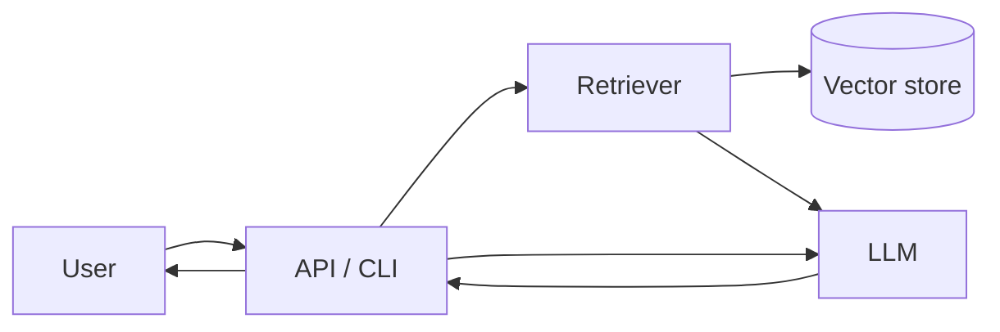

# Project Name

> One-line pitch: what it does, for whom, and the headline number (e.g. "Answers internal policy questions with 92% faithfulness at $0.004 per query").


[](https://github.com/<user>/<repo>/actions/workflows/ci.yml)

## Problem

Describe the concrete problem in two or three sentences. Who has it, why existing solutions fall short, and what "solved" looks like in measurable terms.

## Architecture



Explain the main components, the data flow and where the non-obvious engineering lives (chunking, reranking, caching, guardrails, tool routing, etc.).

## Evaluation

Dataset: `evals/datasets/<name>.jsonl` (N examples). Command: `python evals/run_eval.py`.

| Metric | Baseline | This project | Delta |
|--------|----------|--------------|-------|
| Answer accuracy | 0.00 | 0.00 | +0.00 |
| Faithfulness | 0.00 | 0.00 | +0.00 |
| Retrieval recall@5 | 0.00 | 0.00 | +0.00 |

State how each metric is computed (exact match, LLM-as-judge with which model, human review) and what the baseline is.

## Cost & latency

Prices checked on: YYYY-MM-DD

| Component | Model / service | Cost per request | p50 latency | p95 latency |
|-----------|-----------------|------------------|-------------|-------------|
| Embedding | `<model>` | $0.0000 | 0 ms | 0 ms |
| Generation | `<model>` | $0.0000 | 0 ms | 0 ms |
| **Total** | | **$0.0000** | **0 ms** | **0 ms** |

Measured over N requests on `<hardware / region>`. Note what dominates cost and what you would change at 10x traffic.

## Trade-offs & decisions

- **Decision:** what you chose. **Alternative:** what you rejected. **Why:** the evidence (eval numbers, cost, complexity).
- Repeat for the two or three decisions that mattered most.

## Run it

```bash
git clone https://github.com/<user>/<repo>.git
cd <repo>
cp .env.example .env   # fill in your keys
pip install -e .
python -m <package> --help
python evals/run_eval.py
```

## Limitations & next steps

- Known limitation and its impact.
- What you would build next and the metric it should move.
